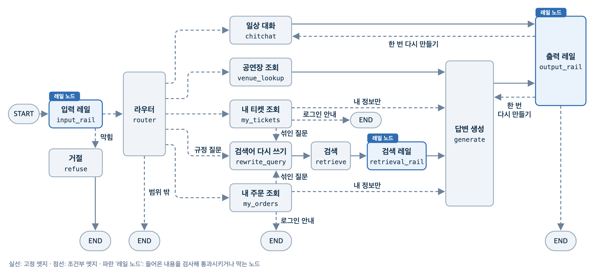

# 교안 01 프로젝트: 레일을 단 루나 팬 챗봇

버추얼 아이돌 **루나**의 팬 상담 챗봇입니다. LangGraph 그래프의 노드로 입력, 검색, 출력 레일을 붙였습니다. 팬이 공연, 티켓, 굿즈, 팬클럽 규정을 물으면 입력 레일 바로 뒤의 라우터 노드가 경로를 고르고, 공지 문서 검색(RAG)이나 DB 조회 결과로 답합니다. 모델이 만든 답은 모두 출력 레일을 지납니다.



| 층 | 막는 것 | 판정 도구 |
|---|---|---|
| 입력 1, 2, 3 | 주입과 탈옥, 유해 범주, 페르소나 정책 위반(여러 턴에 나눠 보낸 공격 포함) | Prompt Guard 2, Llama Guard 3(로컬 모델), Jev |
| 검색 | 검색 문서 속 숨은 지시 | 정규식(NeMo 밖, 그래프 노드가 직접 실행) |
| 출력 1, 2, 3 | 페르소나 정책 위반, 근거에 없는 내용, 공식 밖 링크(개인정보는 가림) | Jev, Jev 사실 대조, Guardrails AI |

레일 사이의 **경로 고르기**는 레일이 아니라 앱의 라우터 노드가 합니다. Jev 가 최근 대화와 마지막 팬 메시지를 보고 경로 후보(`app/core/prompts.py` 의 `ROUTES`: 일상 대화, 공연장, 내 티켓, 내 주문, 내 티켓 + 규정, 내 주문 + 규정, 업무 밖 질문, 검색) 가운데 하나를 고릅니다. 쓸 만한 답이 없거나 Jev 호출이 실패하면 검색 경로로 갑니다. 업무 밖 질문은 `persona.yaml` 의 정해 둔 답(`OOS-07`)으로 끝납니다.

막은 결과에는 흐름 이름(`blocked_by`, NeMo 판정 결과가 알려 준 값)과 규칙 id(`rule_id`, 예: `IN-05`, `OUT-08`)가 남고, 팬에게는 `persona.yaml` 에서 그 규칙에 정해 둔 문장이 나갑니다.

출력 레일이 근거에 없는 내용(`OUT-05`)이나 규정에 없는 예외 약속(`OUT-09`)으로 막으면, 검색과 조회는 다시 하지 않고 이번 턴 근거로 답을 한 번만 다시 만듭니다(`app/core/prompts.py` 의 `RETRY_RULES`). 다시 막히거나 다른 출력 규칙으로 막히면 바로 거절 문장을 보냅니다. 판정 액션이 오류로 끝나면 답을 보내지 않고 규칙 id `RAIL-ERROR`(안내 문장 `REF-10`)로 막습니다.

입력, 출력 레일은 NeMo Guardrails 가 돌립니다. 층 순서와 기준값을 설정 파일로 바꾸고, 같은 모양의 레일 폴더를 다른 앱(교안 02 에이전트)도 쓰고, 판정 액션에 대화 기록을 넘겨 주고, 막은 층 이름을 알려 주기 때문입니다. 검색 레일은 NeMo 가 직접 문서를 찾아 답할 때만 돌고 판정만 묻는 `check_async` 는 돌리지 않으므로, 검색과 답변을 맡은 LangGraph 노드가 직접 검사합니다.

NeMo 대화 레일(임베딩 의도 분류)은 쓰지 않습니다. 정해 둔 답 판단(위기 신호, 다른 팬 정보)은 입력 레일이 이미 하고, 임베딩 유사도는 "루나 안녕! 팬미팅 몇 시야?" 처럼 인사와 질문이 섞인 메시지를 인사로 보내기 때문입니다.

## 준비

1. 저장소 최상위 폴더에서 `uv sync` 로 공용 환경을 맞춥니다.
2. 분류 모델 두 개를 단원 폴더의 `models/` 에 받습니다. 교안 01, 02 프로젝트가 같이 쓰며, 이미 있으면 건너뜁니다.

   ```python
   # 저장소 최상위 폴더에서 uv run python 으로 실행합니다
   import zipfile
   from pathlib import Path

   import gdown

   model_dir = Path("day64_레일통합_실행레일/models")
   MODEL_FILE_IDS = {
       "Llama-Prompt-Guard-2-86M": "1HJJHkiJGTswHo-KszSKSEcwKS4vQYeO_",
       "Llama-Guard-3-1B": "11rauEwmAFzGkjYZ5k17c0TJudx81HOc1",
   }
   model_dir.mkdir(exist_ok=True)
   for model_folder, file_id in MODEL_FILE_IDS.items():
       if (model_dir / model_folder / "model.safetensors").exists():
           continue
       zip_path = model_dir / f"{model_folder}.zip"
       gdown.download(id=file_id, output=str(zip_path))
       with zipfile.ZipFile(zip_path) as archive:
           archive.extractall(model_dir)
       zip_path.unlink()
   ```

3. 이 프로젝트 폴더(`app/` 이 보이는 곳)에서 `.env.example` 을 `.env` 로 복사하고 두 키를 채웁니다. 키가 비어 있으면 앱이 시작할 때 `ValidationError` 로 멈춥니다.

   ```bash
   cp .env.example .env          # Windows PowerShell: Copy-Item .env.example .env
   ```

   | 키 | 용도 | 발급 |
   |---|---|---|
   | `OPENAI_API_KEY` | 답변 모델, 검색어 다시 쓰기, 임베딩, RAGAS 평가 모델 | [OpenAI 콘솔](https://platform.openai.com/api-keys) |
   | `TYPESAFE_API_KEY` | Jev 판정(입력 정책, 출력 정책, 사실 대조, 경로 고르기) | [TypeSafe 콘솔](https://console.typesafe.ai/keys) |

4. 검색 문서 저장소를 한 번 만듭니다(검색 문서 절을 임베딩해 `output/chroma` 에 넣습니다. 비용이 조금 듭니다). 앱, 노트북, 평가는 이 저장소를 열기만 하며, `data/knowledge/*.md` 를 고쳤을 때도 다시 실행합니다.

   ```bash
   uv run -m app.tools.retriever --build
   ```

## 실행

모든 명령은 이 프로젝트 폴더에서 실행합니다. 코드가 `from app...` 으로 서로를 부르므로 파일 경로(`uv run app/main.py`)가 아니라 모듈 이름(`-m app.main`)으로 실행합니다.

```bash
# 터미널 대화(로그인한 팬 F0001). 끝내려면 exit, 끝날 때 찍힌 대화 ID 로 이어 하기
uv run -m app.main --fan F0001
uv run -m app.main --fan F0001 --thread <대화 ID>

# 채팅 화면(왼쪽에서 팬을 고르고, 답 아래 '레일 판정 기록'을 펼쳐 봅니다)
uv run python -m streamlit run app/ui/chat_app.py

# 평가: 빠르게(파일마다 5개, RAGAS 없이) / 최적화용 전체(RAGAS 포함)
uv run -m app.evaluate --run-name quick --split all --limit 5 --no-ragas
uv run -m app.evaluate --run-name rails_full --split 최적화용

# 경로 정확도만(기대 경로가 있는 케이스를 입력 레일과 라우터까지만 돌립니다. 답변 모델 비용 없음, Jev 비용만 듭니다)
uv run -m app.evaluate --run-name routes --split all --routes-only

# 평가 기록 비교(브라우저에서 http://localhost:5050)
uv run mlflow ui --backend-store-uri sqlite:///output/mlflow.db --port 5050

# 테스트(가짜 객체로 돌아 API 를 부르지 않습니다)
uv run pytest -q
```

평가 결과는 `output/eval/<run 이름>.csv` 와 `output/mlflow.db` 에 남습니다. 기대 경로(`expected.route`)가 있는 케이스는 케이스마다 경로 맞음(`route_ok`)이, 요약 지표에는 경로 정확도(`route_accuracy`)가 남습니다. 모듈마다 맨 아래에 확인 블록이 있어 `uv run -m app.graph.nodes` 처럼 한 층만 실행해 볼 수 있습니다.

## 폴더 구조

```
luna_chatbot/
├── app/
│   ├── core/                       # 패키지 (__init__.py 는 빈 파일, 아래 생략)
│   │   ├── config.py               # 경로, 설정(Settings), 모델 객체
│   │   ├── policies.py             # persona.yaml 읽기, 규칙 id 별 정해 둔 답
│   │   ├── prompts.py              # 모델에 보내는 글 모음
│   │   └── schemas.py              # 그래프 실행 값(ChatContext) 모양
│   ├── tools/
│   │   ├── fan_db.py               # 팬 DB 읽기 전용 조회
│   │   ├── retriever.py            # 검색 문서를 절 단위로 저장, 가까운 절 찾기
│   │   └── venue.py                # 공연장 정보, 지도 위치
│   ├── guards/
│   │   ├── actions.py              # NeMo 레일 액션 (함께 따라하기 자리 있음)
│   │   ├── classifiers.py          # 로컬 분류 모델로 주입, 유해 판정
│   │   ├── judges.py               # Jev 로 정책 위반, 근거 확률 판정
│   │   ├── rails.py                # NeMo 판정 객체, 입력 출력 레일 실행
│   │   ├── router.py               # Jev 로 경로 고르기, 위기 신호 고르기
│   │   └── validators.py           # 정규식 검사 (함께 따라하기 자리 있음)
│   ├── graph/
│   │   ├── builder.py              # 노드 등록, 엣지 연결, 그래프 컴파일
│   │   ├── chat.py                 # 대화 한 턴 보내기, 턴 요약
│   │   ├── edges.py                # 갈림길에서 다음 노드 고르기
│   │   ├── nodes.py                # 레일 챗봇 노드
│   │   └── state.py                # 대화 State 모양
│   ├── ui/
│   │   ├── chat_app.py             # Streamlit 채팅 한 페이지
│   │   ├── components.py           # 화면 조각 (말풍선, 카드, 지도, 판정 기록)
│   │   ├── runner.py               # 비동기 그래프용 이벤트 루프 하나
│   │   └── style.css               # 화면 스타일
│   ├── main.py                     # 터미널 여러 턴 대화
│   └── evaluate.py                 # 골든셋과 레드팀 평가, 성적표 기록
├── data/
│   ├── luna_fan.db                 # 팬, 공연, 주문 등 DB (읽기 전용)
│   ├── knowledge/                  # 공지, 규정 문서 5개 (검색 원본)
│   ├── persona/persona.yaml        # 시스템 프롬프트, 정책, 안내 문장 원본
│   ├── image/luna_avatar.png       # 채팅 화면의 루나 얼굴
│   └── eval/
│       ├── golden_set/cases.json   # 평가 문항 (정상, 경계)
│       └── red_team/cases.json     # 평가 문항 (공격)
├── rails/guard/
│   ├── config.yml                  # 레일 층 순서 목록 (함께 따라하기 자리 있음)
│   └── rails.co                    # 레일 흐름과 기준값 (함께 따라하기 자리 있음)
├── images/
│   ├── flow.png                    # 흐름 그림
│   └── l1_overview.png             # README 의 전체 노드 흐름도
├── tests/
│   ├── conftest.py                 # 가짜 키, 모델, 레일, Jev, 검색기 준비
│   ├── test_config.py              # 경로, 레일 설정, Settings 값 확인
│   ├── test_evaluate_scorecard.py  # 성적표, 경로 정확도 계산 확인
│   ├── test_graph_flow.py          # 여러 턴과 경로별 노드 확인
│   ├── test_layers.py              # 아래 층이 위 층을 import 하지 않는지 확인
│   ├── test_live.py                # 실제 API 호출 (RUN_LIVE=1 일 때만)
│   ├── test_nodes.py               # 노드 하나씩 State 칸 확인
│   ├── test_policies_prompts.py    # persona.yaml 글이 프롬프트로 이어지는지 확인
│   ├── test_rails_messages.py      # 레일 판정 메시지 변환, 결과 정리
│   ├── test_regenerate.py          # 출력 레일이 막았을 때 다시 쓰기 여부
│   ├── test_retriever.py           # 검색 저장소 만들기와 열기
│   ├── test_ui.py                  # 화면과 이벤트 루프 확인
│   └── test_venue.py               # 공연장 정보, Nominatim 질의 확인
├── README.md
├── .env.example                    # 환경 변수 견본 (.env 로 복사해 키를 채움)
├── .gitignore
└── pytest.ini                      # 테스트 설정
```

위 층(graph, 실행)만 아래 층(core, tools, guards)을 부릅니다(`tests/test_layers.py` 가 확인합니다).

| 바꿀 것 | 고칠 곳 | 다시 할 일 |
|---|---|---|
| 시스템 프롬프트, 거절 문장, Jev 입력, 출력 정책 문구 | `data/persona/persona.yaml` | 앱을 다시 실행(시작할 때 읽습니다) |
| 레일 층 순서, 층 빼기 | `rails/guard/config.yml` 의 `flows` 목록(한 줄이 한 층) | 앱을 다시 실행 |
| 판정 기준값(0.5 같은 숫자) | `rails/guard/rails.co` 의 흐름 안 숫자 | 앱을 다시 실행 |
| 경로 후보와 설명 | `app/core/prompts.py` 의 `ROUTES` (경로를 더하면 `app/graph/edges.py` 의 `ROUTE_NODES` 도) | 앱을 다시 실행 |
| 판정 도구(분류 모델, 검증기)와 레일 액션 | `app/guards/` | 앱을 다시 실행 |
| 답변, 일상 대화, 검색어 다시 쓰기 규칙 | `app/core/prompts.py` | 앱을 다시 실행 |

`rails/` 폴더는 직접 고치는 레일의 원본입니다. 만드는 스크립트가 없으므로 고친 뒤 다시 만드는 단계도 없습니다. 팬에게 보낼 문장은 `rails/` 에 옮겨 적지 않고 `persona.yaml` 한 곳에 둡니다.

## 데이터

| 경로 | 들어 있는 것 | 누가 쓰나 |
|---|---|---|
| `data/luna_fan.db` | 팬, 공연, 공연장, 좌석 등급, 티켓, 상품, 주문, 환불 등 테이블과 기준 시각(`meta`) | 조회 노드, 공연장 도구(읽기만 합니다) |
| `data/knowledge/` | 공지, 규정 문서 5개. `## [절 id] 제목` 절 하나가 검색 단위 | 검색 저장소 만들기(`app.tools.retriever --build`) |
| `data/persona/persona.yaml` | 시스템 프롬프트, 입력, 출력 정책, 규칙 id 별 안내 문장의 원본 | 프롬프트 층, 레일 액션, 거절 노드 |
| `data/image/luna_avatar.png` | 화면에 쓰는 루나 얼굴 그림 | 채팅 화면 |
| `data/eval/golden_set/cases.json`, `data/eval/red_team/cases.json` | 평가 문항(정상, 경계 / 공격). 파일 맨 위 `field_guide` 에 칸 설명이 있습니다 | 평가(`app.evaluate`), 노트북 7절 |

정책 문구를 바꿀 때는 `persona.yaml` 만 고칩니다. DB, 검색 문서, 평가 문항은 수업용으로 맞춰 둔 값이라 고치지 않습니다.
